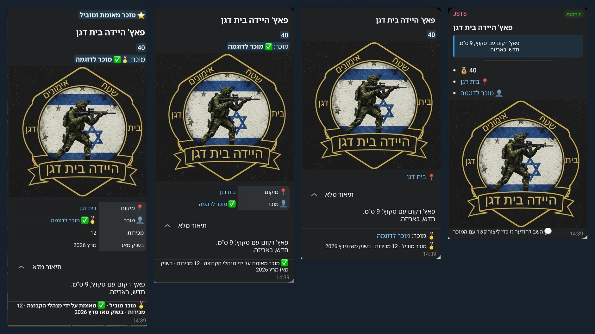

# מכירה

הכול קורה בצ'אט פרטי עם הבוט.

## פרסום פוסט

1. שולחים <code dir="ltr">/newPost</code>.
2. עונים על השאלות: כותרת, תיאור, מחיר, מיקום, תמונות או סרטונים. בסיום התמונות לוחצים **✅ סיימתי**.
3. בודקים את התצוגה המקדימה ולוחצים **✅ אישור ושליחה**.

אם יש כבר פוסט בתהליך, הבוט שואל אם **▶️ המשך** או **🔄 התחל מחדש**. הפקודה <code dir="ltr">/cancel</code> מבטלת אותו. פוסט שהתחלתם נשמר גם אם הבוט עולה מחדש, אבל אחרי זמן ללא פעילות הוא פג.

מילה חסומה בפוסט? הבוט יגיד איזו מילה, ויבקש את אותו שדה שוב.

## מה קורה אחרי השליחה

- **מוכר חדש:** מנהל בודק את הפוסט קודם, והוא מתפרסם אחרי האישור.
- **מוכר מוכר:** מי שכבר היה לו פוסט מאושר או נמכר, ולא הוסר לו פוסט ב-90 הימים האחרונים, מתפרסם מיד. מנהל בודק אחרי הפרסום.
- **נדחה?** תקבלו הודעה עם הסיבה וכפתור **✏️ תקן ושלח שוב**.

## ניהול הפוסטים

<code dir="ltr">/myposts</code> מציג את הפוסטים שלכם:

- **⬆️ הקפץ פוסט:** מחזיר את הפוסט למעלה. יש מגבלה יומית.
- **💸 עדכון מחיר:** הורדת מחיר מפרסמת את הפוסט מחדש ולא נספרת כהקפצה. העלאת מחיר נספרת כהקפצה.
- **🤝 סמן כנמכר:** מסמן את הפוסט בקבוצה כנמכר. פוסט מאושר מסתיים כך, ואי אפשר למחוק אותו בעצמכם.

אחרי 30 יום בלי הקפצה המודעה פגה, והפוסט נשאר בקבוצה. ב-<code dir="ltr">/myposts</code> יופיע **🔄 פרסום מחדש**.

## מוכר מוביל ומוכר מאומת

לחלק מהמוכרים יש סימון ליד הפוסט:

- **🏅 מוכר מוביל:** הסימון מגיע לבד, למוכר שכבר הסתיימו לו כמה מודעות ורובן נמכרו.
- **✅ מוכר מאומת:** מנהלי הקבוצה נותנים את הסימון ידנית.
- **שניהם:** מוכר מוביל שגם אומת.

הפוסטים שלהם מוצגים בתצוגה עשירה יותר, עם מספר המכירות ומתי הצטרפו לשוק.

מימין לשמאל: רגיל, 🏅 מוכר מוביל, ✅ מוכר מאומת, שניהם. (פוסט לדוגמה.)

**איך מגיעים ל-🏅:** כשפריט נמכר, לוחצים **🤝 סמן כנמכר** ב-<code dir="ltr">/myposts</code>. מודעה שפגה בלי סימון, או שהוסרה, נספרת כמודעה שלא נמכרה. [הכלל המדויק](Moderating.md#verified-and-top-sellers).

## בקרוב

התכונות האלה נפתחות בהדרגה, ואולי עוד לא פעילות:

- **פוסט בהודעה אחת:** שולחים לבוט תמונה עם כיתוב: מה, מחיר, איפה. הוא בונה מזה טיוטה ושואל רק מה שחסר.
- **הוספה מהקבוצה:** פרסמתם מכירה בקבוצה? תקבלו הודעה פרטית שרק אתם רואים, עם **✅ הוספה** לשוק, **לא עכשיו** או **לא לשאול שוב**. הבוט לא נוגע בהודעה שלכם.
- **תזכורת הקפצה:** אחרי 7 ימים הודעה פרטית עם הקפצה או נמכר.

